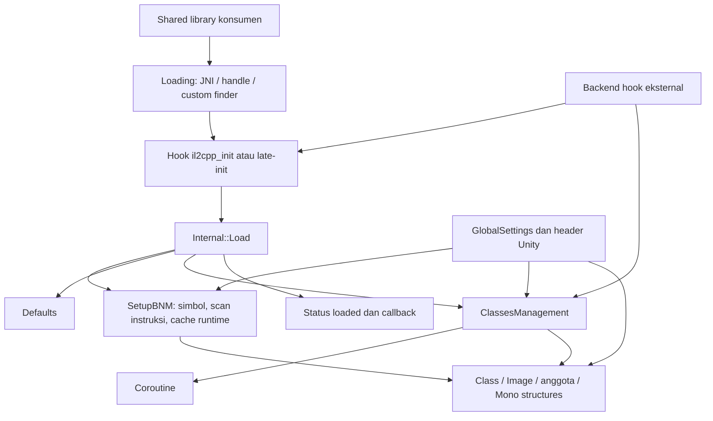

> Catatan historis: status perbaikan review lanjutan ada di [TODO.md](TODO.md). Hasil baseline di bawah bukan sertifikasi stabilitas HEAD atau runtime Unity.

# BNM-Android — Engineering Review

> **Pembaruan:** Refactor dan review akhir berada di Bagian 18–21.
> Phase 2–3 dimulai pada Bagian 11. Bagian 1–10 adalah
> catatan historis Phase 1; pernyataan “belum dijalankan” di sana berlaku untuk
> sesi reconnaissance. Hasil baseline aktual terdapat pada Bagian 12–13.

- **Tanggal:** 17 Oktober 2026
- **Tahap:** Phase 1–3 historis; Phase 4–7 refactor fitur inti dan verifikasi native
- **Branch:** `feat/refactor`
- **Commit yang diperiksa:** `bfc76e5`
- **Status awal Phase 1:** working tree bersih; tidak ada source atau konfigurasi yang diubah.
- **Status tindak lanjut:** refactor fitur inti diimplementasikan; lihat Bagian 18–21 untuk perubahan, hasil aktual dan batas verifikasinya.

## 1. Ringkasan Eksekutif dan Cakupan

BNM memiliki pembagian API yang cukup jelas, tetapi implementasinya sangat bergantung pada layout dan perilaku internal IL2CPP. Prioritas berikutnya adalah memastikan kontrak inisialisasi, kompatibilitas, dan ownership sebelum melakukan perubahan struktural.

Pemeriksaan mencakup implementasi pada 17 berkas `src/*.cpp`, `src/private/Internals.hpp`, konfigurasi build, header publik yang terkait alur utama, bagian setup dan status verifikasi dokumentasi, serta riwayat perubahan sumber.

Pemeriksaan header IL2CPP dilakukan pada selector versi dan beberapa struktur representatif. **Seluruh 342 header versi dan seluruh implementasi matematika belum diaudit secara mendalam.** Laporan ini merupakan reconnaissance, bukan hasil audit menyeluruh atau sertifikasi keamanan runtime.

## 2. Arsitektur yang Dipahami

| Bagian | Lokasi | Tanggung jawab |
|---|---|---|
| API publik | `include/BNM/` | Lookup class, method, field, property, event, generics, containers, hooks |
| Loading | `src/Loading.cpp`, `src/Hooks.cpp` | Menemukan IL2CPP, memasang hook, menyiapkan runtime BNM |
| State internal | `src/private/Internals.hpp`, `src/Internals.cpp` | Tabel fungsi, cache tipe, registry kelas, callback, status loading |
| Metadata | `Class.cpp`, `Image.cpp`, `*Base.cpp` | Enumerasi dan resolusi metadata serta akses anggota |
| ClassesManagement | `ClassesManagement.cpp` | Membuat/mengubah class, method, field, hierarchy, dan vtable |
| Managed structures | `BasicMonoStructures.hpp`, `ComplexMonoStructures.hpp`, `MonoStructures.cpp` | Representasi String, Array, List, Dictionary |
| Fitur tambahan | `Coroutine.cpp`, `Delegates.cpp`, `Exceptions.cpp`, `UnityStructures.cpp` | Coroutine, delegate, exception bridge, struktur Unity |
| Kompatibilitas | `UserSettings/`, `Il2CppHeaders.hpp`, `Il2CppHeaders/` | Konfigurasi dan pemilihan layout Unity |
| Dependensi vendored | `external/` | UTF8-CPP |
| Dokumentasi | `README.md`, `docs/DOCS.md`, `CHANGELOG.md` | Integrasi, API, perubahan, bukti verifikasi historis |

BNM adalah **static library**, bukan aplikasi. Tidak ditemukan implementasi entrypoint aplikasi, Java/Kotlin, Gradle, `RegisterNatives`, atau `JNI_OnLoad` milik library. `JNI_OnLoad` dalam header merupakan contoh untuk aplikasi konsumen.

Tidak ditemukan test suite, konfigurasi CI, maupun binary backend hooking yang dilacak Git.

## 3. Peta Dependensi dan Alur Runtime



Alur konkret dalam [`Loading.cpp`](src/Loading.cpp), terutama `Internal::Load()`:

1. Konsumen menyediakan `JNIEnv`, handle library, atau pencari simbol.
2. BNM memasang hook `il2cpp_init`; late-init tersedia sebagai opsi.
3. Hook menjalankan `Internal::Load()`.
4. `SetupBNM()` mengisi tabel fungsi, menelusuri instruksi untuk fungsi internal, dan membuat template metadata List.
5. BNM memuat Defaults, mendaftarkan coroutine, memproses custom classes, lalu memuat tipe coroutine.
6. Status loaded ditetapkan dan callback dijalankan.

`TrySetupByUsersFinder()` masuk langsung ke `Load()`. Dokumentasi API mensyaratkan IL2CPP sudah siap dan menganjurkan pemanggilan dari thread IL2CPP.

Keterikatan yang penting:

- `Internals.hpp` menghubungkan hampir semua subsistem melalui global state.
- `Class` memakai fungsi internal; setup fungsi internal juga memakai `Class` untuk lookup lanjutan. Ini merupakan ketergantungan saat bootstrap.
- Coroutine bergantung pada ClassesManagement.
- Pencocokan signature method berulang di lookup, virtual hooking, dan ClassesManagement.
- Representasi internal seperti `_data` dan tipe IL2CPP terlihat melalui header publik. Perubahan layout dapat memengaruhi konsumen meskipun nama fungsi tetap.

## 4. Asumsi Build dan Kompatibilitas

Dari [`CMakeLists.txt`](CMakeLists.txt) dan [`Android.mk`](Android.mk):

- Kedua build script mencantumkan **17 source yang sama**, sesuai isi `src/`.
- C++20 diwajibkan. CMake menghasilkan target `BNM` static dengan PIC dan default `Release`.
- CMake mengaktifkan warning termasuk conversion/sign-conversion; daftar warning ndk-build lebih pendek.
- `BNM_LINK_LOG` default `OFF`; backend hook dan kebutuhan link konsumen harus dipenuhi integrator.
- `BNM_SANITIZERS` meneruskan ASan/UBSan secara `PUBLIC`. Implementasinya tidak dibatasi ke Debug meskipun deskripsi opsi menyebut Debug.
- ABI, minimum Android API, serta pilihan STL tidak ditetapkan oleh repository.
- Kode scanner mempunyai cabang ARMv7, ARM64, x86, dan x86_64. RISC-V ditolak melalui `#error`. Ini menunjukkan jalur implementasi, belum membuktikan dukungan runtime.
- `Android.mk` **sudah** menetapkan `LOCAL_C_INCLUDES`; yang belum tersedia adalah ekspor include ke konsumen. Informasi build internal di `AGENTS.md` sudah tertinggal.

Environment menyediakan NDK berlabel `29.0.14206865`. Compiler yang dijalankan melaporkan Clang 21 dengan provenance `llvm-custom`; reproduksi nanti perlu mencatat bahwa ini bukan bukti pengujian memakai distribusi NDK standar.

Konfigurasi saat ini pada [`GlobalSettings.hpp`](include/BNM/UserSettings/GlobalSettings.hpp):

- `UNITY_VER=222`, `UNITY_PATCH_VER=32`; selector memilih `2022.2.9f1.h`.
- ClassesManagement, Coroutine, dan allocator IL2CPP aktif.
- Sinkronisasi opsional default nonaktif.
- Pemeriksaan tambahan dan logging bergantung pada `NDEBUG`.
- Backend hook belum dipilih; terdapat `#error` aktif. Hambatan build ini terlihat dari sumber, **belum diuji kompilasi pada sesi ini**.

Pemilihan header merupakan konfigurasi compile-time, bukan deteksi versi runtime. Batas penting mencakup perubahan parameter method pada 2021.2, patch khusus 2021.1.24, dan perubahan struktur Unity 6. Memiliki header yang cocok belum menjamin pola scanner, calling convention, dan perilaku GC cocok.

## 5. Ownership, JNI, dan Lifecycle

Wrapper `Class`, `Image`, dan anggota menyimpan pointer metadata; wrapper tersebut bukan pemilik runtime IL2CPP.

Ada beberapa domain alokasi:

- Objek managed melalui API IL2CPP.
- Alokasi fixed GC melalui `BNM::Allocate/Free`.
- Metadata buatan, nama, tabel method, dan cache melalui `BNM_malloc/free`.

`Array::Destroy()` membedakan alokasi berdasarkan `klass == nullptr`. Kontrak ini perlu dipertahankan dan diuji sebelum penerapan RAII.

Makro custom class memakai static initialization dengan `init_priority(101–103)`. Registrasi terjadi sebelum pemrosesan saat loading.

Tidak ditemukan API shutdown terpadu atau jalur `dlclose` pada implementasi. Metadata yang telah dipublikasikan tampak diasumsikan hidup selama runtime; ini perlu dikonfirmasi, bukan langsung dianggap kebocoran yang boleh dibebaskan.

`TryLoadByJNI()` memakai `JNIEnv` milik pemanggil. `AttachIl2Cpp/DetachIl2Cpp` mengelola thread IL2CPP, **bukan** attachment JVM.

## 6. Temuan Awal Berdasarkan Severity

Temuan berikut berasal dari pembacaan implementasi; belum direproduksi melalui pengujian sesi ini.

### P0 — Belum Ditetapkan

Ini bukan kesimpulan bahwa seluruh repository bebas masalah kritis.

### P1 — Inisialisasi Class Memiliki Cache Tanpa Sinkronisasi

- **Lokasi:** [`src/Class.cpp`](src/Class.cpp), `Class::TryInit()`; baris 386 pada commit yang diperiksa.
- **Bukti dan akar masalah:** melakukan `insert` ke static `unordered_set` tanpa lock dan menandai class sebelum `Class$$Init` selesai. Flag sinkronisasi BNM tidak melindungi bagian ini.
- **Kondisi dan dampak:** pemanggilan bersamaan dapat merusak container atau melewati inisialisasi yang masih berlangsung.
- **Rekomendasi:** evaluasi penghapusan cache atau pengelolaan status inisialisasi yang benar.
- **Risiko kompatibilitas/regresi:** mutex sederhana berisiko deadlock saat reentrancy; perubahan harus mempertahankan layout publik dan semantik inisialisasi.
- **Verifikasi:** harness concurrent dan recursive initialization, kemudian pengujian runtime.

### P1 — Kegagalan Resolusi Dapat Menjadi Pembacaan Alamat Tidak Valid

- **Lokasi:** [`src/Loading.cpp`](src/Loading.cpp), `Internal::SetupBNM()` dan `AssemblerUtils::FindNextJump()`; baris 329 dan 254 pada commit yang diperiksa.
- **Bukti dan akar masalah:** hasil pencarian simbol diteruskan ke scanner, termasuk pemanggilan bertingkat. Scanner membaca memori tanpa validasi alamat awal; hasil gagal `0` dapat menjadi input scan berikutnya.
- **Kondisi dan dampak:** simbol tidak tersedia atau pola instruksi berbeda dapat menyebabkan pembacaan alamat tidak valid dan crash saat setup.
- **Rekomendasi:** validasi tiap tahap dan hentikan setup dengan diagnosis yang jelas.
- **Risiko kompatibilitas/regresi:** strategi fallback yang sekarang implisit perlu dipahami sebelum diubah.
- **Verifikasi:** finder palsu yang mengembalikan null serta fixture instruksi tanpa branch.

### P1 — Error Path JNI Belum Dijaga Menyeluruh

- **Lokasi:** [`src/Loading.cpp`](src/Loading.cpp), `Loading::TryLoadByJNI()`; baris 80 pada commit yang diperiksa.
- **Bukti dan akar masalah:** hasil lookup method/field dan `applicationInfo` digunakan pada operasi berikutnya tanpa pemeriksaan lengkap; tidak ada pemeriksaan pending Java exception.
- **Kondisi dan dampak:** kegagalan lookup atau pemanggilan Java dapat berlanjut menjadi penggunaan JNI tidak valid.
- **Rekomendasi:** pemeriksaan bertahap, pengelolaan local reference, dan kebijakan exception yang eksplisit.
- **Risiko kompatibilitas/regresi:** exception tidak boleh dihapus diam-diam karena dapat mengubah perilaku konsumen.
- **Verifikasi:** CheckJNI dengan jalur gagal.

### P2 — Konversi Container Mengandalkan Kesamaan Layout

- **Lokasi:** [`src/Image.cpp`](src/Image.cpp), `Image::GetClasses()`; baris 59 pada commit yang diperiksa.
- **Bukti dan akar masalah:** `vector<Il2CppClass*>` diakses sebagai `vector<Class>`. Kesamaan ukuran elemen tidak membuat kedua spesialisasi container dapat dipertukarkan secara sah.
- **Dampak:** akses melalui tipe container yang tidak sesuai membawa risiko undefined behavior dan ketergantungan pada implementasi standard library.
- **Rekomendasi:** gunakan `reserve` lalu `emplace_back` setiap pointer.
- **Risiko kompatibilitas/regresi:** API dapat dipertahankan; pastikan urutan dan identitas elemen tidak berubah.
- **Verifikasi:** urutan, jumlah, dan identitas class, termasuk hasil kosong.

### P2 — Baseline Regresi Belum Tersedia sebagai Artefak Repository

- **Bukti:** dokumentasi menyebut harness dan pengujian historis, tetapi test tersebut tidak ditemukan dalam berkas terlacak.
- **Dampak:** perubahan berikutnya belum memiliki baseline yang dapat dijalankan ulang dari repository.
- **Rekomendasi:** sediakan baseline reproduktif dan pisahkan pengujian komponen murni dari integrasi Unity.
- **Risiko:** test yang terlalu bergantung pada runtime akan sulit dijalankan tanpa perangkat dan proyek target.
- **Verifikasi:** jalankan kembali baseline dari checkout dan konfigurasi yang tercatat.

### P3 — Dokumentasi Konfigurasi Perlu Diselaraskan

- **Bukti:** include internal ndk-build sudah tersedia; deskripsi sanitizer menyebut Debug tanpa pembatasan implementasi; pesan backend menyebut XOFHook tanpa blok implementasi.
- **Dampak:** instruksi integrasi dapat menyesatkan atau tidak sesuai konfigurasi aktual.
- **Rekomendasi:** koreksi dokumentasi setelah konfigurasi aktual diverifikasi.
- **Risiko:** rendah untuk koreksi dokumentasi; jangan mengubah perilaku build hanya untuk menyesuaikan deskripsi.
- **Verifikasi:** cocokkan instruksi dengan build script dan hasil baseline.

## 7. Pemeriksaan yang Dijalankan dan Hasil Aktual

Perintah yang digunakan mencakup:

- `git status --short --branch`, `git diff --stat`, dan `git log`.
- `rg --files --hidden`, `rg -n`, `git ls-files`.
- Pembacaan implementasi dengan `cat`, `sed`, dan `nl`.
- Skrip Python read-only untuk membandingkan daftar source dan menghitung header.
- Pembacaan NDK `source.properties`.
- `"$ANDROID_NDK_HOME/toolchains/llvm/prebuilt/linux-arm64/bin/aarch64-linux-android21-clang++" --version`.

Hasil: working tree bersih saat reconnaissance, daftar source sinkron, 342 header IL2CPP tersedia, compiler dapat dijalankan.

**Build, syntax check, test, sanitizer, dan pengujian perangkat belum dijalankan**, sesuai pembatasan Phase 1. Tidak ada hasil build atau test lulus yang diklaim untuk sesi ini. `#error` backend adalah hambatan yang ditemukan melalui inspeksi sumber, bukan hasil eksekusi build.

## 8. Ketidakpastian dan Perilaku yang Belum Diverifikasi

- Versi Unity lengkap, ABI, minimum Android API, backend hook, dan konfigurasi STL proyek target.
- Kesesuaian pola instruksi scanner dengan binary target dan opsi optimisasinya.
- Kontrak pemanggilan API dari worker thread, termasuk callback saat loading.
- Umur objek managed, rooting, dan kebutuhan write barrier ketika reference ditulis langsung.
- Apakah unload/reload library termasuk skenario yang harus didukung.
- Validasi ClassesManagement, generic invocation, dan coroutine pada runtime nyata.

Bagian 25 dari [`docs/DOCS.md`](docs/DOCS.md) mencatat uji normal loading, lookup, method/field, dan hooking pada satu game/configuration. Dokumentasi juga mencatat build historis memakai stub backend. Bukti tersebut berguna, tetapi belum mencakup matriks kompatibilitas dan bukan hasil pengujian sesi ini.

## 9. Prioritas dan Usulan Langkah Berikutnya

1. Lanjutkan audit mendalam pada loading, scanner, JNI, dan threading.
2. Tetapkan baseline build dengan konfigurasi target yang diketahui, termasuk Debug/Release dan instansiasi template API publik.
3. Buat reproduksi kecil untuk temuan yang terkonfirmasi.
4. Perbaiki kegagalan inisialisasi dan memory safety secara terpisah, dengan API tetap.
5. Audit ownership metadata, ClassesManagement, containers, dan coroutine.
6. Setelah perilaku terukur, pisahkan resolver/scanner dan accessor versi dari orkestrasi loading. Ini memungkinkan pengujian mandiri tanpa memindahkan seluruh API atau mengubah layout publik.

Belum ada alasan untuk melakukan rewrite besar atau mengganti pointer runtime secara menyeluruh dengan smart pointer. Setiap perubahan struktural harus didahului bukti kebutuhan dan verifikasi perilaku.

## 10. Catatan Perubahan dan Keputusan

- Reconnaissance tidak mengubah source, `AGENTS.md`, konfigurasi build, compiler standard, ABI, atau API.
- `REVIEW.md` ditambahkan setelah laporan awal atas permintaan pengguna untuk menyimpan hasil pemeriksaan.
- Temuan statis, bukti historis, dan hasil eksekusi sesi ini dibedakan secara eksplisit.
- Persetujuan menyimpan laporan tidak dianggap sebagai persetujuan memulai refactor.
- Tahap yang diusulkan selanjutnya adalah **Phase 2–3: audit mendalam dan baseline**, kemudian penyajian rencana perbaikan sebelum implementasi.

## 11. Phase 2–3 — Ringkasan Audit Mendalam

Audit lanjutan dilakukan atas persetujuan pengguna pada source `bfc76e5`.
**Source produksi, header produksi, build script, dan AGENTS.md tetap tidak
diubah.** Perubahan sesi ini berupa laporan dan alat reproduksi di `tools/audit/`.

Kesimpulan: baseline kompilasi cukup luas dapat dibangun setelah backend
dikonfigurasi pada salinan terisolasi, tetapi ada cacat runtime yang dapat
direproduksi. Kompilasi lintas versi bukan bukti keselamatan lifetime, threading,
GC, atau kompatibilitas instruksi pada binary Unity tertentu.

Pemeriksaan mendalam berfokus pada loading/JNI, scanner, state dan cache,
CompileTimeClass, ClassesManagement, containers, coroutine, serta akses metadata
dan API publik. Clang static analyzer dijalankan pada seluruh 17 translation unit.
Seluruh implementasi matematika dan kesetaraan setiap header vendored terhadap
runtime Unity asli belum diverifikasi; ini tetap batas cakupan, bukan klaim lolos.

Hal yang sudah membantu maintainability: daftar source kedua build system sama,
include publik CMake terpropagasi ke konsumen, selector versi menolak versi tak
terpetakan, dan accessor versi untuk parameter/member metadata mulai terpusat.
Fondasi tersebut sebaiknya dipertahankan selama perbaikan.

## 12. Baseline Aktual dan Konfigurasi

### 12.1 Metode dan Environment

- Host eksekusi: Android ARM64 melalui Termux, tanpa VM Unity.
- NDK: `29.0.14206865`; compiler melaporkan Android Clang 21.0.0 dari
  `llvm-custom`. CMake: `4.1.2-dirty`, Ninja dari direktori CMake SDK.
- Baseline utama: Unity `222/32`, Android API 21; konfigurasi sementara karena
  detail proyek target belum diberikan selama sesi ini.
- Snapshot: `build/audit-phase23/snapshot/`. Hanya konfigurasi backend pada
  salinan `GlobalSettings.hpp` yang diubah: blok Dobby yang sudah ada diaktifkan
  dan blok dummy digantikan. Diff tersimpan di `settings.patch`.
- Stub `dobby.h` selalu mengembalikan kegagalan. Ia tidak memasang hook dan tidak
  boleh digunakan pada produk/game. Library hook nyata tidak diuji.
- Manifest SHA-256 input asli, command argv, exit code, dan output lengkap
  disimpan di `build/audit-phase23/`. Ringkasan permanen sesi ada pada
  [`tools/audit/results.json`](tools/audit/results.json).
- ASan/UBSan menginstrumentasi source BNM aktual pada snapshot. Probe mengisi
  tabel API IL2CPP dengan fixture minimal; fixed allocator diganti malloc/free.
  Pengujian ini tidak mensimulasikan collector maupun seluruh metadata Unity.

### 12.2 Hasil Build dan Analisis

| Pemeriksaan | Hasil aktual | Batas bukti |
|---|---|---|
| Syntax check `src/Class.cpp` pada tree asli | Gagal, exit 1, `GlobalSettings.hpp:213`: backend belum dipilih | Baseline kegagalan konfigurasi; tidak disembunyikan |
| CMake ARM64 Debug / Release | Berhasil; 0 / 1 warning | Static archive, stub backend |
| CMake ARMv7 Debug / Release | Berhasil; 0 / 1 warning | Static archive, belum dijalankan pada ARMv7 |
| CMake x86 Debug / Release | Berhasil; 17 / 18 warning | Static archive, belum dijalankan pada x86 |
| CMake x86_64 Debug / Release | Berhasil; 17 / 18 warning | Static archive, belum dijalankan pada x86_64 |
| Konsumen CMake ARM64 Debug | Berhasil menghasilkan shared library melalui `add_subdirectory` dan link `BNM log dl` | Membuktikan propagasi include dan link dengan stub |
| ndk-build ARM64 Debug / Release | Berhasil; 0 / 1 warning | `APP_CPPFLAGS=-fexceptions -frtti`, STL static, stub backend |
| Matriks Unity | 38/38 pilihan versi/patch lolos syntax check API yang diinstansiasi | Enam pilihan juga memeriksa seluruh 17 `.cpp`; bukan seluruh kombinasi ABI/fitur |
| Feature variants | Sync, DOTNET35, dan minimal lolos; Unity 6006 ditolak oleh static assertion | Sync/minimal mencakup seluruh source; dua fixture API diperiksa di setiap varian |
| ASan + UBSan build ARM64 | Archive dan executable probe berhasil dibangun | Runtime probe menemukan kegagalan; bukan sanitizer-clean |
| clang-tidy `clang-analyzer-*` | Seluruh 17 `.cpp` selesai, exit 0, dengan 32 diagnostic warning | Exit 0 tidak berarti tanpa temuan |

Enam pilihan yang menjalankan seluruh source pada matriks adalah `56/0`,
`172/0`, `211/24`, `222/9`, `6003/3`, dan `6005/1`. Pilihan lainnya memeriksa
`public_api.cpp`, mencakup kedua sisi threshold selector. Daftar persis ada di
`baseline.py` dan catatan hasil. Warning matriks dihitung per kemunculan, termasuk
pengulangan dari header: flags matriks awal tidak menonaktifkan warning ekstensi
identifier `$`, sehingga jumlahnya tidak sebanding dengan build CMake.

Warning build utama berasal dari `paramCount` yang tidak digunakan ketika
logging Release nonaktif (`ClassesManagement.cpp:121`) dan konversi signedness
hash karakter pada x86 (`BasicMonoStructures.hpp:636`).

Varian sync/DOTNET35/minimal masing-masing menghasilkan 4/4/3 warning pada
fixture API. Unity 6006 menghasilkan dua error selector (satu per fixture),
sesuai kontrak penolakan versi yang belum dipetakan.

Triage analyzer: 17 diagnostic menyarankan pengurangan padding pada layout
vendored `Il2CppInternalThread`; **jangan menata ulang field ABI untuk mengikuti
saran ini**. Diagnostic lain menyoroti nullable allocation/argument, dan satu
potential leak `newConstructor` pada `SetupBNM`. Alokasi metadata yang
dipublikasikan tidak boleh langsung dibebaskan; masa hidupnya harus ditentukan
sebelum menganggap diagnostic leak itu sebagai bug yang telah terbukti.

### 12.3 Perintah Reproduksi

Perintah utama yang dijalankan dari root repository:

```sh
python3 tools/audit/baseline.py --mode prepare
python3 tools/audit/baseline.py --mode build --cmake /data/data/com.termux/files/home/android-sdk/cmake/4.1.2/bin/cmake --ninja /data/data/com.termux/files/home/android-sdk/cmake/4.1.2/bin/ninja
python3 tools/audit/baseline.py --mode matrix
python3 tools/audit/baseline.py --mode integration --cmake /data/data/com.termux/files/home/android-sdk/cmake/4.1.2/bin/cmake --ninja /data/data/com.termux/files/home/android-sdk/cmake/4.1.2/bin/ninja
python3 tools/audit/baseline.py --mode probes --cmake /data/data/com.termux/files/home/android-sdk/cmake/4.1.2/bin/cmake --ninja /data/data/com.termux/files/home/android-sdk/cmake/4.1.2/bin/ninja
python3 tools/audit/baseline.py --mode scanner
python3 tools/audit/baseline.py --mode analyze
python3 tools/audit/baseline.py --mode variants
```

`prepare` menolak menimpa snapshot. Gunakan `--out build/nama-baru` untuk
reproduksi baru. Detail cara menjalankan dan interpretasi exit code ada pada
[`tools/audit/README.md`](tools/audit/README.md). Script mengumpulkan kegagalan
tanpa menghentikan seluruh audit; exit code script bukan verdict test suite.

## 13. Reproduksi Runtime dan Hasil Negatif

Probe dijalankan sebagai proses terpisah. Exit `-6` pada catatan Python berarti
abort/SIGABRT, bukan test lulus. Leak detection dimatikan; tidak ada klaim bebas
leak. Tidak ada eksekusi ThreadSanitizer atau CheckJNI pada JVM nyata.

| Probe | Hasil aktual | Interpretasi |
|---|---|---|
| `positive` | Exit 0, `list and class lookup control=1` | Kontrol lookup dan Add/Insert/Remove pada fixture berfungsi |
| `copy-lifetime` | ASan heap-use-after-free, exit -6 | Salinan CompileTimeClass memakai descriptor yang sudah dibebaskan |
| `const-generic` | Exit 1, jumlah argumen `1 → 0` | Resolve const memutasi descriptor generic bersama |
| `class-publication` | Exit 1, pemanggil kedua kembali sebelum init pertama selesai | Cache memublikasikan class terlalu dini; ini bukan uji data race TSan |
| `dictionary-holes` | Exit 1, live entry 1 tetapi size/key count 2 | Slot terhapus ikut dihitung/diekspor |
| `array-overflow` | ASan heap-buffer-overflow, exit -6 | Ukuran alokasi wrap, kapasitas besar tetap diterima |
| `coroutine-yield` | Exit 1, `progress=2 klass=0x0` | Null yield dilewati dan wrapper tidak memiliki class IL2CPP |
| `coroutine-temporary` | ASan stack-use-after-scope, exit -6 | Pola penggunaan temporary seperti contoh dokumentasi menghasilkan pointer dangling |
| `missing-symbol` | ASan melaporkan SEGV baca alamat 0, exit -6 | Setup meneruskan simbol null ke scanner |
| `hook-failure` | Exit 1, loader result 1, original null | Backend gagal tetapi loader melaporkan sukses |
| `custom-method-limit` | UBSan member access pada MethodInfo null, exit -6 | Guard 256 parameter tidak ditangani caller |
| `mapped-not-readable` | Exit 1, mapping `PROT_NONE` diterima | IsAllocated bukan pemeriksaan hak baca atau lifetime |
| Scanner `rel32` | Exit 1, expected `0x1000`, actual `0x100001000` | Displacement negatif x86_64 tidak di-sign-extend |
| Scanner `signed-char` | UBSan load dengan ruang objek tidak cukup, exit -6 | Byte 0xE8 menghasilkan indeks negatif ke tabel hex |

Probe scanner mengekstrak `AssemblerUtils` aktual, hanya mengganti nama simbol
preprocessor arsitektur agar cabang x86_64 dapat dijalankan di ARM64, dan memakai
`-fsigned-char`. Algoritma tidak diubah, tetapi ini **bukan eksekusi native x86**.

## 14. Temuan Terprioritas dan Rekomendasi

Tidak ditetapkan P0 pada sesi ini. P1 berarti risiko crash/korupsi yang signifikan
pada kondisi pemicu yang disebutkan, bukan klaim bahwa semua game langsung gagal.
Nomor baris berikut mengacu pada source `bfc76e5`; simbol adalah acuan utama.

### P1-01 — Ownership Salinan CompileTimeClass Tidak Aman

**Lokasi:** `Class.hpp::CompileTimeClass`, `Utils.hpp::ForwardList` copy constructor,
`Class.cpp::ToClass/Free` (505–568). Copy menduplikasi node list tetapi membagi
pointer `_BaseInfo` dan bit autoFree. Resolve non-const pertama membebaskan
descriptor; resolve salinan membaca memori yang telah dibebaskan. **Terbukti ASan**
melalui `copy-lifetime`, menggunakan copy biasa dari hasil builder publik.

**Koreksi:** tetapkan ownership descriptor yang konsisten, misalnya deep copy
descriptor beserta generic arguments atau storage bersama yang memiliki lifetime
jelas. Jangan hanya menghapus satu pemanggilan `Free()`. **Risiko:** perubahan
ukuran/semantik copy tipe publik dan alokasi tambahan; mempertahankan layout
perlu dipertimbangkan. **Verifikasi:** copy/move/assignment, dua resolve,
resolve const/non-const, nested generic, Free eksplisit, ASan dan leak harness.

### P1-02 — Coroutine Mengembalikan Alamat Wrapper dengan Lifetime Salah

**Lokasi:** `Coroutine.hpp::promise_type::get_return_object` (102),
`Coroutine.cpp::IEnumerator::Get/MoveNext` (172–190), contoh DOCS bagian 17.2.
`get_return_object()` menghasilkan nilai C++; `Get()` mengembalikan `this`.
`MyCoroutine().Get()` meninggalkan pointer ke temporary yang sudah mati pada
akhir statement. **Terbukti ASan stack-use-after-scope.** Wrapper juga tetap
`klass == nullptr`, dan `Get()` melewati yield null (`progress` menjadi 2).

**Koreksi:** pisahkan pemilik coroutine frame dari objek IEnumerator yang valid
untuk Unity; tetapkan transfer ownership, finalization, copy/move, dan semantik
yield. **Risiko:** ini memerlukan desain terarah dan verifikasi integrasi, bukan
sekadar mengalokasikan wrapper dengan `new`. **Verifikasi:** lifetime setelah
temporary hilang, null yield, completion, cancel/reset, GC/finalizer Unity.

Tambahan statis: `WaitUntil/WaitWhile` menetapkan `std::function` pada memori dari
`CreateNewInstance` tanpa konstruksi subobjek C++ yang terlihat; allocator IL2CPP
tidak menjalankan constructor C++. `unhandled_exception()` juga kosong. Keduanya
perlu masuk desain lifetime/error coroutine; belum diuji dengan VM asli.

### P1-03 — Cache Class dan Publikasi Runtime Tidak Menjamin Kesiapan

**Lokasi:** `Class.cpp::Class::TryInit` (386), `Internals.hpp::States`,
`Utils.cpp::IsLoaded`, `Hooks.cpp`, `Loading.cpp::Load`.
Set class ditulis sebelum `Class$$Init` selesai. Probe mengonfirmasi akses kedua
kembali terlalu dini. Insert bersamaan ke `unordered_set` juga tidak dilindungi.
`states.state` merupakan bit-field biasa; atomic `isLoading` tidak otomatis
memublikasikan seluruh state kepada pembaca `IsLoaded`. Cache List dan operasi
callback juga tidak tercakup oleh lock loading opsional.

**Koreksi:** model status loading dan publication yang eksplisit; evaluasi perlu
tidaknya cache TryInit, lalu lindungi cache yang tetap diperlukan. **Risiko:**
reentrancy IL2CPP dan callback bisa deadlock jika mutex membungkus pemanggilan
runtime tanpa analisis. **Verifikasi:** slow init, concurrent lookup, init gagal,
recursive init, callback reentrant, lalu stress/TSan pada harness yang mendukung.

### P1-04 — Scanner Memakai Alamat yang Belum Tervalidasi

**Lokasi:** `Loading.cpp::SetupBNM/FindNextJump/ReadMemory` (208, 254, 329).
Simbol null diteruskan ke `memcpy` pembaca instruksi; **SEGV alamat 0 terbukti**.
Scan bertingkat juga memakai hasil 0 dari scan sebelumnya. Batas 4096 byte bukan
batas mapping executable; pembacaan berikutnya dilakukan setelah offset
dinaikkan, termasuk offset 4096 saat loop akan berakhir.

**Koreksi:** validasi simbol dan hasil tiap tahap, batas rentang baca, serta
propagasi kegagalan sebelum memasang hook atau menandai loaded. **Risiko:** pola
fallback/version-specific harus dipertahankan hanya jika valid. **Verifikasi:**
missing symbol, tidak ada branch, branch di ujung buffer, mapping pendek,
instruksi yang berubah, dan binary Unity target.

### P1-05 — Scanner x86 Memiliki Dua Kesalahan Representasi

**Lokasi:** `Loading.cpp::ReadMemory` (215) dan `DecodeBranchOrCall` (243).
`char` signed dengan byte >= 0x80 menjadi indeks negatif setelah `>> 4`.
Displacement CALL rel32 ditambahkan sebagai bilangan unsigned tanpa sign
extension 32 ke 64 bit; backward call x86_64 salah sebesar 4 GiB.
**Reproduksi:** UBSan untuk byte 0xE8 dan mismatch target rel32 pada probe hasil
ekstraksi. Pembacaan byte-per-byte x86 juga bukan decoding batas instruksi penuh.

**Koreksi:** gunakan byte unsigned dan displacement bertipe `int32_t`; uji
pencarian pada batas instruksi yang sah. **Risiko:** perubahan jalur x86 jangan
mengubah decoder ARM yang sudah memiliki aturan berbeda. **Verifikasi:** branch
maju/mundur, batas signed rel32, semua nilai byte, lalu native x86/x86_64.

### P1-06 — Error JNI Dapat Dilanjutkan dengan Reference/ID Tidak Valid

**Lokasi:** `Loading.cpp::TryLoadByJNI` (80–140).
Lookup method/field dan hasil `getApplicationInfo` tidak dijaga lengkap sebelum
panggilan JNI berikutnya; tidak ada pemeriksaan pending exception. Context yang
dibuat sendiri juga tidak dilepas secara eksplisit. Pada thread native terpasang
yang berulang memanggil loader, local reference dapat tertahan sampai frame/thread
dibersihkan. **Status:** temuan statis; belum diuji CheckJNI.

**Koreksi:** RAII untuk reference yang dimiliki, validasi setiap tahap, kebijakan
propagasi exception. **Risiko:** jangan menghapus exception milik caller atau
menghapus borrowed context. **Verifikasi:** CheckJNI, lookup gagal, context null,
exception Java, dan loop pada attached thread berumur panjang.

### P1-07 — Batas Parameter Custom Method Berakhir pada Null Dereference

**Lokasi:** `ClassesManagement.cpp::ProcessCustomMethod/CreateMethod` (635/733),
caller `ModifyClass` (124–126) dan `CreateClass` (243 dst.). Guard >255 parameter
mengembalikan null, tetapi caller tetap membaca/menulis `myInfo`.
**Terbukti UBSan** melalui `ProcessClassRuntime` dengan 256 parameter.

**Koreksi:** validasi descriptor sebelum mutasi metadata, lalu tangani kegagalan
di semua caller. Audit narrowing `field_count/method_count/vtable_count` juga
diperlukan: `CreateClass` mengalokasikan field menurut jumlah yang sudah dicast
ke uint16, tetapi mengiterasi vector asal. **Risiko:** jangan menerbitkan class
setengah jadi. **Verifikasi:** 255/256 parameter, 65535/65536/65537 field dengan
fixture terkontrol, allocation failure, rollback tanpa metadata parsial.

### P1-08 — Pertumbuhan Layout Class yang Sudah Memiliki Instance

**Lokasi:** `ClassesManagement.cpp::ModifyClass`, blok penambahan field (147–181).
Fungsi menaikkan `instance_size`, mengganti metadata field dan offset, tetapi
tidak memperbesar objek yang sudah dialokasikan. Jika class telah memiliki
instance, akses field baru melalui instance lama dapat keluar dari alokasinya.
Pemanggilan di main thread saja tidak menyelesaikan persoalan lifetime ini.
**Status:** kesimpulan statis bersyarat; belum diuji pada game.

**Koreksi:** tentukan batas lifecycle yang mengizinkan perubahan layout; pisahkan
modifikasi method dari perluasan instance. **Risiko:** pembatasan baru dapat
menolak penggunaan lama; perlu keputusan API/kontrak sebelum implementasi.
**Verifikasi:** instance dibuat sebelum dan sesudah modifikasi pada proyek Unity
milik pengguna, plus GC dan inheritance; jangan mengasumsikan realokasi aman.

### P1-09 — Ukuran Alokasi Array Dapat Overflow

**Lokasi:** `BasicMonoStructures.hpp::Array<T>::Create` (244–258).
`sizeof(Array) + sizeof(T) * capacity` tidak dicek overflow. Pada jalur forced
allocation, kapasitas `SIZE_MAX / sizeof(uint64_t) + 1` menghasilkan alokasi
header saja, tetapi kapasitas besar tetap disimpan. Write elemen pertama yang
berada dalam kapasitas deklaratif menyebabkan **ASan heap-buffer-overflow**.

**Koreksi:** checked arithmetic dan penanganan allocation failure sebelum
memset/write; audit panjang bertipe signed pada operasi List juga.
**Risiko:** tentukan hasil error/null konsisten dengan caller yang sekarang
menganggap allocation selalu berhasil. **Verifikasi:** batas ukuran, 0, OOM,
kapasitas besar yang ditolak tanpa allocation, jalur GC asli dan forced allocator.

### P2-01 — Status Keberhasilan Hook Tidak Diteruskan

**Lokasi:** `GlobalSettings.hpp` blok Dobby, `Loading.cpp::CheckHandle` dan
`TryLoadByUsersFinder` (56/152). Dobby wrapper mengabaikan return code, sedangkan
loader mengembalikan true setelah menemukan simbol. **Terbukti:** stub selalu
gagal, tetapi loader result=1 dan original pointer=null.

**Koreksi:** kontrak hasil backend internal dan propagasi gagal tanpa mengubah
public loader signature. **Risiko:** Dobby dan ShadowHook memiliki bentuk hasil
berbeda; jangan menganggap pointer target berarti hook berhasil. **Verifikasi:**
backend gagal/sukses, symbol missing, late-init, retry, original pointer valid.

### P2-02 — Resolve Generic Const Mengubah Descriptor Bersama

**Lokasi:** `Class.cpp::ProcessGenericInfo` (481) dan `ToClass() const` (546).
Salinan const masih berbagi `_GenericInfo`; processor melakukan `clear()` pada
`_types`. **Terbukti:** jumlah argumen descriptor asli berubah 1 menjadi 0.

**Koreksi:** resolve tanpa mutasi descriptor bersama, selaras dengan perbaikan
ownership P1-01. **Risiko:** caching/autoFree nested generic harus tetap benar.
**Verifikasi:** resolve const berulang menghasilkan argumen dan tipe yang sama,
termasuk jika resolver runtime gagal sementara.

### P2-03 — Dictionary Mengembalikan Slot yang Sudah Dihapus

**Lokasi:** `ComplexMonoStructures.hpp`, cabang non-`BNM_DOTNET35`,
`GetSize/ToMap/GetKeys/GetValues` (97–128).
Semua slot sampai `count` diekspor tanpa memperhitungkan `freeCount` dan marker
entry kosong. **Terbukti pada layout yang direpresentasikan:** satu live entry
dan satu removed entry menghasilkan size=2 dan dua key.

**Koreksi:** gunakan jumlah live entry dan filter marker yang sesuai layout.
**Risiko:** jangan menerapkan aturan satu Dictionary layout pada semua versi
.NET/Unity atau cabang DOTNET35. **Verifikasi:** remove, reuse free slot, clear,
key default yang valid, dan pembandingan dengan Dictionary managed target.

### P2-04 — Type Punning Container dan Wrapper Tidak Dijamin C++

**Lokasi:** `Image.cpp::GetClasses` (59), serta `cast()` pada `*Base.hpp`.
`vector<Il2CppClass*>` diakses sebagai `vector<Class>`; ukuran elemen yang sama
bukan jaminan legalitas tipe container. `cast()` juga mengembalikan derived
reference dari objek yang dapat berupa base object saja. **Status:** kesimpulan
statis; compilation/sanitizer silence tidak membuktikan akses tersebut sah.

**Koreksi:** untuk vector, `reserve` + `emplace_back(pointer)` mempertahankan API.
Untuk wrapper, evaluasi konversi nilai atau view yang sah secara lifetime.
**Risiko:** mengubah return reference `cast()` bisa memengaruhi chaining dan
mutasi caller, sehingga jangan diganti massal. **Verifikasi:** urutan/identitas
class, instance binding, temporaries, const caller, dan optimized builds.

### P2-05 — Fallback Split APK Tidak Menggunakan Daftar Split

**Lokasi:** `Loading.cpp::TryLoadByJNI` (106, 128–135).
Saat library tidak diekstrak, `cDir` berisi `ApplicationInfo.sourceDir` (path APK),
tetapi fallback mencari substring `/lib/`. Path biasa seperti
`/data/app/pkg/base.apk` tidak memenuhi kondisi itu, sehingga split tidak dicoba.
Kode juga membentuk nama split dari ABI tanpa membaca `splitSourceDirs`.
**Status:** kontradiksi alur/path statis; belum diuji paket split nyata.

**Koreksi:** enumerasi split APK dari ApplicationInfo dengan error handling JNI.
**Risiko:** tetap dukung extracted libraries, base APK, dan custom loader.
**Verifikasi:** paket base-only, ABI split, extracted/non-extracted pada perangkat.

### P2-06 — IsAllocated Bukan Validasi Objek atau Hak Akses

**Lokasi:** `Utils.hpp::IsAllocated` (36–49).
`mincore` dipakai sebagai pemeriksaan mapped page; **probe menerima `PROT_NONE`**.
Release hanya mengecek non-null. Pointer dangling pada page yang masih mapped
juga tidak dapat dibedakan dari objek hidup oleh fungsi ini.

**Koreksi:** dokumentasikan kemampuan terbatas helper dan gunakan ownership,
state/lifetime serta validasi metadata pada boundary yang relevan. **Risiko:**
jangan menggantinya dengan handler signal global atau menjanjikan arbitrary
pointer safety. **Verifikasi:** null, mapped/unmapped, PROT_NONE, dan objek yang
masa hidupnya dikelola secara eksplisit.

### P2-07 — Penanganan Allocation Failure Tidak Konsisten

**Lokasi:** `Utils.hpp::ForwardList::Add` (254–256),
`ClassesManagement.cpp::CreateMethod/MakeImage/SetupField`, alokasi template List
di `Loading.cpp`. Pointer hasil malloc langsung digunakan; analyzer juga
menandai beberapa lokasi tersebut. **Status:** temuan statis pada kondisi OOM;
belum ada fault-injection menyeluruh.

**Koreksi:** kebijakan alokasi/error terpusat dan rollback sebelum publikasi
metadata. **Risiko:** exception tidak boleh menyeberangi boundary runtime secara
tidak terkontrol. **Verifikasi:** allocator injection gagal pada setiap tahap,
tidak ada metadata parsial, double-free, atau flag loaded yang salah.

### P3 — Warning dan Dokumentasi Baseline

Warning Release dan signedness x86 di Bagian 12 adalah pre-existing, bukan
regresi audit. Dokumentasi lama yang menyebut seluruh build bersih tidak berlaku
untuk flags/ABI yang baru diperiksa. Deskripsi sanitizer khusus Debug dan include
internal ndk-build juga perlu diselaraskan. Koreksi dokumentasi tidak memerlukan
perubahan ABI atau compiler standard; verifikasi melalui command yang tercatat.

## 15. Batas Kompatibilitas dan Risiko yang Masih Perlu Bukti Runtime

- Tabel fungsi IL2CPP, pemanggilan function pointer hasil cast, hidden MethodInfo,
  value-type/generic invocation, dan return struct memerlukan verifikasi calling
  convention per ABI. `Method::Call` masih melanjutkan jika jumlah argumen
  berbeda; parameter type/return type template merupakan kontrak caller.
- Akses langsung `std::vector` milik internal IL2CPP mengasumsikan kompatibilitas
  standard-library ABI dan lifetime container antar-library.
- `Field::Set`, Array/List/Delegate melakukan write reference langsung. Kebutuhan
  GC write barrier/rooting pada konfigurasi collector target belum diuji. Belum
  dinyatakan sebagai korupsi GC yang telah direproduksi.
- Metadata buatan memakai penanda `num_mods=31`, sentinel image
  `-0x424e4d`, dan flag ownership pada `Il2CppClass::flags`. Harus diperiksa pada
  boundary Unity yang ditargetkan sebelum mengubah layout atau konstanta ini.
- Tidak ada shutdown/unload terpusat. Jangan membebaskan metadata yang sudah
  direferensikan IL2CPP hanya untuk menghilangkan diagnostic leak.
- Callback loading dipanggil saat optional loading mutex masih dipegang;
  direct setup tidak memakai gate atomic yang dipakai hook. Reentrancy/retry
  memerlukan kontrak eksplisit, bukan asumsi bahwa satu mutex melindungi semua API.
- `MulticastDelegateBase::Add` tetap no-op jika `delegates` null, sebagaimana
  dicatat dokumentasi. Ini belum diubah dan perlu tes single-handler transition.
- Uji historis satu game tetap diperlakukan sebagai bukti terpisah dari probe
  native sesi ini. Tidak ada uji real Dobby/ShadowHook, JVM CheckJNI, GC Unity,
  unload/reload, atau seluruh kombinasi Unity/ABI/fitur pada sesi ini.

## 16. Rencana Refactor yang Diusulkan — Belum Diimplementasikan

| Urutan | Perubahan terisolasi | Alasan / dependensi | Verifikasi sebelum lanjut |
|---|---|---|---|
| 1 | Validasi resolusi dan hasil hook, propagasi error loading | Cegah crash dan false success sebelum state runtime tersedia; menyentuh Loading/Hooks/backend adapter | Missing symbol, backend failure, late-init, retry |
| 2 | Checked allocation dan validasi descriptor custom | Cegah overflow/null dereference sebelum mutasi metadata | Boundary sizes, 255/256 parameter, OOM injection |
| 3 | Ownership CompileTimeClass | Hilangkan UAF dan mutasi generic bersama; pertahankan interface bila memungkinkan | Seluruh copy/move/const/generic probes dan ASan |
| 4 | State publication dan cache class | Kesiapan harus terlihat konsisten antar-thread; desain untuk reentrancy | Concurrent init, recursive callback, failure/retry |
| 5 | JNI resource/error handling dan split discovery | Pisahkan pencarian path dari pemasangan hook agar dapat diuji | CheckJNI dan fixture packaging Android |
| 6 | Lifetime coroutine dan managed bridge | Wrapper/value dan GC memiliki ownership berbeda; perubahan ini perlu proyek Unity uji | Temporary, null yield, cancel/completion, GC/finalizer |
| 7 | Konversi vector dan Dictionary live entries | Perbaikan lokal dengan API tetap; wrapper cast ditangani terpisah | Urutan elemen, removed slot, template/API compile |
| 8 | Pisahkan decoder dan accessor versi internal | Memungkinkan test komponen murni tanpa VM; dilakukan setelah behavior baseline jelas | Fixture ISA dan matriks selector/ABI |

Tidak diusulkan perubahan minimum Android API, compiler standard, nama library,
atau packaging. Perubahan yang berpotensi memengaruhi layout publik, reference
return, atau dukungan mutasi class hidup harus dibahas secara khusus. Setiap
perbaikan menghasilkan regression test dari reproduksi terkait sebelum beralih
ke refactor struktural berikutnya.

## 17. Berkas yang Ditambahkan/Diubah pada Sesi Audit

| Berkas | Tujuan |
|---|---|
| `REVIEW.md` | Mempertahankan Phase 1 dan menambahkan hasil Phase 2–3, evidence, severity, batasan, rencana |
| `tools/audit/baseline.py` | Snapshot terisolasi, runner build/matriks/analyzer/probe, pencatatan command dan exit code |
| `tools/audit/public_api.cpp` | Instansiasi template API untuk pemeriksaan kompilasi |
| `tools/audit/extended_api.cpp` | Instansiasi custom class, UnityEvent, dan coroutine |
| `tools/audit/probes.cpp` | Reproduksi bug dengan runtime fixture dan kontrol positif |
| `tools/audit/README.md` | Instruksi reproduksi, prasyarat, batasan dan interpretasi hasil |
| `tools/audit/results.json` | Ringkasan hasil serta excerpt diagnostic dari eksekusi aktual |

Snapshot, binary, dan raw logs berada di ignored `build/audit-phase23/` dan tidak
ditambahkan sebagai source proyek. Tidak ada perubahan implementasi produksi.
Pemeriksaan SHA-256 setelah eksekusi menemukan nol perubahan pada input
`src/`, `include/`, dan `external/` yang dicatat sebelum baseline.
Tahap berikutnya adalah persetujuan prioritas/rencana perbaikan, kemudian
implementasi bertahap; menyelesaikan audit ini tidak otomatis memulai refactor.

## 18. Refactor Fitur Inti — Ringkasan Implementasi

Refactor dilanjutkan atas instruksi pengguna “perbaiki semuanya” dengan perhatian
utama pada fitur inti. Perubahan dilakukan pada wrapper/runtime yang telah
diaudit; vendor layout IL2CPP, pemetaan Unity, standar C++20, minimum API
konsumen, nama library, dan daftar 17 source tidak diubah. `AGENTS.md` yang sudah
ada tidak dimodifikasi. Belum ada commit/push.

Arsitektur tetap: consumer → Loading/finder/backend → tabel API & VMData →
Class/Method/Field/Image → optional ClassesManagement/Coroutine. Perubahan
internal memusatkan gate loading, memisahkan snapshot callback dari mutex,
memeriksa alokasi metadata, dan memperjelas ownership descriptor serta frame
coroutine. Tidak ditambahkan dependency eksternal.

### Status temuan setelah implementasi

| ID audit | Perubahan dan bukti pengujian | Batas yang tersisa |
|---|---|---|
| P1-01 | `Class.cpp`/`Class.hpp`: copy descriptor mendalam, move transfer, destructor dan generic destruction; copy-lifetime/copy-move/const-generic lulus | String nama tetap pinjaman; rebuild semua consumer karena special member berubah |
| P1-02 | Coroutine native move-only; Get membuat proxy managed dan mentransfer handle; MoveNext mempertahankan null yield, completion false; Reset/finalizer idempotent; predicate dibangun dengan placement construction | Rooting capture, incremental GC, finalizer dan scheduler Unity belum diuji pada player |
| P1-03 | Cache prematur TryInit dihapus; runtime menjadi pemilik sinkronisasi class; loaded state atomic, gate direct/hook sama, callback/map/list cache disinkronkan | Penulisan metadata dan patch code tetap membutuhkan safe point; bukan jaminan semua API thread-safe |
| P1-04 | `Loading.cpp`: null/batas mapping diperiksa sebelum scan, tidak ada read tambahan di offset 4096; SetupBNM mengembalikan gagal | Masih memakai heuristik instruksi/version; mapping dapat berubah setelah pemeriksaan |
| P1-05 | Byte scanner unsigned; displacement x86 rel32 di-sign-extend; tes decoder dan guard-page lulus | Logika x64 diuji di host ARM64, bukan eksekusi binary x86 |
| P1-06 | JNI local frame/UTF RAII, exception dan ID lookup diperiksa, exception dipertahankan; fixture error paths lulus | Belum CheckJNI/framework Android nyata, termasuk fallback ActivityThread |
| P1-07 | Jumlah parameter/counter/size/field span divalidasi sebelum mutasi, hasil method null tidak didereference; limit 256 ditolak pada fixture | Boundary penuh metadata/generic dari player belum tersedia |
| P1-08 | Pertumbuhan field/reparent existing class ditolak; class baru tetap dapat dibuat dan dipanggil pada fixture | Perubahan perilaku sengaja membatasi penggunaan lama yang tidak aman |
| P1 tambahan saat review | Publikasi class ditunda sampai metadata lengkap; hierarchy baru dialokasikan sebelum yang lama dibebaskan; nested owner memeriksa keberadaan target dan kapasitas | Pembaca runtime tidak otomatis mengikuti mutex BNM |
| P2-01 | Dobby adapter menghormati return code; loader awal gagal bila hook gagal; setup membatalkan hook internal yang sudah terpasang saat pemasangan berikutnya gagal | Backend asli dan unhook dengan callback yang masih berjalan belum diverifikasi; late-init tetap opsi best-effort |
| P2-02 | Processor generic tidak memaksa autoFree atau mengosongkan argumen sumber | Resolusi generic nyata memerlukan mscorlib/Unity |
| P2-03 | Dictionary non-DOTNET35 melewati entry terhapus dan menghitung live count; fixture lulus | Berlaku untuk layout hashCode/freeCount yang direpresentasikan header |
| P2-04 | Image membangun vector<Class> secara normal; cast() membuat typed wrapper by value | Binding reference/mutasi wrapper sumber harus dimigrasikan |
| P2-05 | Split discovery memakai array splitSourceDirs; fixture JNI memeriksa cleanup saat semua path gagal | Keberhasilan membuka APK ZIP nyata belum diuji |
| P2-06 | IsAllocated mode pemeriksaan memakai readable mapping; PROT_NONE ditolak | Bukan validasi lifetime objek atau fungsi async-signal-safe; Release tanpa flag tetap null check |
| P2-07 | Alokasi diperiksa, metadata di-zero-init, exception ditahan pada boundary; probe Array/List OOM dan alokasi metadata pertama lulus | **Mitigasi parsial:** rollback semua alokasi dan hook pada setiap titik OOM belum transaksional; tidak boleh replay mutasi setelah gagal |
| P3 | Warning paramCount dan signed hash diperbaiki; deskripsi sanitizer/backend dikoreksi; migrasi dan tes didokumentasikan | Saran padding layout vendor tidak diterapkan karena merusak ABI |

Tidak ada temuan P0 yang telah dibuktikan. Tabel ini bukan klaim bahwa seluruh
kerentanan atau seluruh versi Unity telah diuji.

## 19. Keputusan Kompatibilitas dan File Berubah

Perubahan API yang diperlukan untuk menghapus UB:

- `MethodBase/FieldBase/PropertyBase/EventBase::cast()` mengembalikan nilai,
  sehingga tidak membentuk reference ke derived object yang tidak pernah ada.
  Gunakan `auto typed = base.cast<T>()`; binding `auto &` perlu diperbarui.
- `IEnumerator` tidak dapat disalin; gunakan move atau langsung `.Get()`.
  `.Get()` tidak mengonsumsi yield. Native wrapper yang tidak diserahkan ke Unity
  membebaskan frame lewat destructor.
- Perubahan layout class yang sudah ada ditolak; buat class baru untuk field baru.
- Method call dengan jumlah argumen salah ditolak alih-alih menebak calling
  convention. Bentuk template tipe dan hidden IL2CPP parameters tetap kontrak ABI.

File implementasi yang berubah dan alasannya:

| File | Alasan |
|---|---|
| `include/BNM/Class.hpp`, `src/Class.cpp` | Ownership descriptor, generic const, runtime initialization, guard resolusi awal |
| `include/BNM/BasicMonoStructures.hpp`, `ComplexMonoStructures.hpp` | Overflow/OOM/bounds dan Dictionary live entries |
| `include/BNM/Coroutine.hpp`, `src/Coroutine.cpp` | Frame/proxy lifetime, current field untuk descriptor GC, completion/predicate handling |
| `include/BNM/MethodBase.hpp`, `FieldBase.hpp`, `PropertyBase.hpp`, `EventBase.hpp`, `Method.hpp` | Wrapper value dan validasi pemanggilan method |
| `src/Loading.cpp`, `src/Hooks.cpp` | Resolusi/hook failure, bounded scan, JNI, loading gate dan callback |
| `src/ClassesManagement.cpp` | Prevalidation, checked allocation, publikasi metadata dan batas perubahan layout |
| `src/Internals.cpp`, `src/private/Internals.hpp` | State atomic, mutex/cache dan ownership map internal |
| `src/MonoStructures.cpp`, `src/Delegates.cpp` | Cache list dan guard hasil alokasi |
| `src/Image.cpp` | Hilangkan vector type punning |
| `include/BNM/Utils.hpp`, `src/Utils.cpp` | ForwardList allocation/copy, readable mapping, guard allocator/thread APIs |
| `include/BNM/UserSettings/GlobalSettings.hpp` | Return status Dobby, include ShadowHook, koreksi pesan backend; pilihan backend default tetap wajib |
| `CMakeLists.txt` | Deskripsi opsi sanitizer saja; flag/build behavior tidak berubah |
| `tests/core_regressions.cpp`, `tests/check_results.py`, `tests/README.md` | Regresi fitur inti, gate hasil aktual dan freshness input |
| `tools/audit/baseline.py` | Mode regression dengan exit gagal, scanner guard-page dan executable test fixture |
| `tools/audit/refactor-results.json` | Hasil command setelah refactor, terpisah dari baseline |
| `README.md`, `CHANGELOG.md`, `docs/DOCS.md`, `docs/REFACTOR.md`, `REVIEW.md` | Kontrak/migrasi, hasil verifikasi, risiko dan tindak lanjut |

## 20. Verifikasi Setelah Refactor

Snapshot akhir berada di `build/refactor-verified/`; semua perintah menyimpan
argv, exit code, durasi dan output di `logs/`. CMake/Ninja yang dipakai tetap
SDK CMake 4.1.2; NDK tetap 29.0.14206865, API 21. Snapshot hanya mengaktifkan
blok backend Dobby dengan stub gagal, tidak mengubah konfigurasi backend source.

Perintah yang dijalankan dari root (tambahkan opsi path CMake/Ninja SDK bila
binary tidak ada pada PATH):

```sh
python3 tools/audit/baseline.py --mode prepare --out build/refactor-verified
python3 tools/audit/baseline.py --mode build --out build/refactor-verified
python3 tools/audit/baseline.py --mode regression --out build/refactor-verified
python3 tools/audit/baseline.py --mode scanner --out build/refactor-verified
python3 tools/audit/baseline.py --mode matrix --out build/refactor-verified
python3 tools/audit/baseline.py --mode variants --out build/refactor-verified
python3 tools/audit/baseline.py --mode integration --out build/refactor-verified
python3 tools/audit/baseline.py --mode analyze --out build/refactor-verified
python3 tests/check_results.py build/refactor-verified
git diff --check
```

| Pemeriksaan | Hasil aktual akhir |
|---|---|
| Source tanpa backend dipilih | Gagal exit 1, satu `#error` backend yang memang diwajibkan; bukan build produksi berhasil |
| CMake 4 ABI × Debug/Release | **8/8 berhasil, 0 warning** pada flags CMake proyek |
| Shared-library consumer ARM64 | Configure/link berhasil, 0 warning |
| ndk-build ARM64 Debug/Release | **2/2 berhasil, 0 warning** |
| ASan/UBSan archive dan executable fixture | Build/link berhasil |
| Regresi native ARM64 Debug | **20/20 berhasil**, tanpa laporan ASan/UBSan; leak detection disabled |
| Decoder x64 di host ARM64 | **3/3 berhasil**: signed byte, rel32 mundur, null/guard-page |
| Matrix header Unity | **38/38 berhasil**; API di seluruh selector, full source pada enam boundary representatif |
| Variasi fitur | Sync dan minimal: source + API berhasil; DOTNET35: API compile berhasil |
| Unity 6006 unsupported | Gagal exit 1 dengan dua static-assert yang diharapkan |
| clang-tidy analyzer, 17 source | Exit 0 seluruhnya; **17 diagnostic padding vendor berulang**, tanpa diagnostic null/leak/pointer subtraction yang tersisa dari run ini |
| Gate hasil/freshness | **PASS**, 403 input production cocok manifest snapshot akhir |
| Diff whitespace | `git diff --check` berhasil |

Warning matrix tidak sama dengan warning build CMake: mode matrix sengaja
mengaktifkan `-Wpedantic` tanpa suppressions dollar identifier yang ada di CMake,
serta menangkap beberapa diagnostic header lama. Varian sync/DOTNET35 masing-masing
memiliki satu warning `offsetof` pada fixture macro custom class non-standard-layout;
minimal tanpa warning. Jangan mengubah layout vendor untuk menghilangkan padding.

Ada **116 outcome command** dalam `tools/audit/refactor-results.json`.
Setelah full matrix awal, analyzer menemukan pointer subtraction pada offset
coroutine. Koreksi satu baris disalin ke snapshot setelah proses sebelumnya selesai;
manifest/analyzer sebelumnya disimpan di `review-history/`. Delapan build CMake,
regresi, consumer/ndk-build, dan analyzer Coroutine diulang. Translation unit
Coroutine juga diperiksa ulang pada enam boundary matrix dan dua varian source
(`review-*` logs); source lain tidak berubah. Gate memeriksa timestamp hasil ulang
agar tidak menerima build sebelum refresh snapshot.

Fixture positif mencakup Class/Image lookup, method call dan arity rejection,
get/set field, invoke hook dan original pointer, pembuatan custom class/method,
List/Dictionary, descriptor copy/move/const generic, serta coroutine null yield,
completion, temporary, reset dan finalize. Injeksi malloc menguji kegagalan
alokasi metadata pertama; belum merupakan sweep seluruh titik alokasi.

Probe audit lama tidak digunakan sebagai gate setelah refactor: probe tersebut
sengaja mendereference array overflow dan proxy coroutine tanpa fixture managed,
dan mengasumsikan GetClass kedua kembali prematur. Pada percobaan awal sesudah
perbaikan, probe lama tersebut menghasilkan abort/timeout. Tes regresi pengganti
memeriksa penolakan null/overflow, initializer yang benar-benar memblokir, serta
proxy managed sintetis. Baseline crash lama tetap tersimpan; tidak dihapus untuk
menampilkan hasil seolah-olah selalu lulus.

## 21. Review Setelah Refactor dan Pekerjaan Tersisa

**Tujuan review:** menjaga lookup, invocation, hook, collections, custom class,
dan coroutine sambil menghilangkan defect memory/lifecycle yang dibuktikan audit.
Review dilakukan pada diff dan implementasi hasil akhir, disertai fixture native,
compiler matrix dan analyzer; tidak menggunakan sub-agent atau reviewer manusia.

Review menemukan dan memperbaiki publikasi metadata terlalu dini, urutan alokasi
hierarchy, dan pointer subtraction pada offset current coroutine. Pengujian
positif class baru, method/field, hook invocation dan list membantu memastikan
penanganan error tidak sekadar menonaktifkan fitur inti. Tidak ada blanket rewrite
vendor header, penggantian backend produksi, atau penyembunyian compile failure.

**Verdict:** perbaikan siap dievaluasi dalam integrasi; belum layak dinyatakan
terverifikasi untuk rilis Unity hanya berdasarkan compilation/fixture.

Prioritas berikutnya:

1. **P1, verifikasi runtime:** jalankan pada proyek Unity milik pengguna dengan
   versi lengkap termasuk patch, backend, ABI, API Android dan mode GC yang
   dipakai. Uji normal/late init, callback bersamaan, hook/unhook yang sedang
   dieksekusi, method overload/generic/value type, dan coroutine finalizer/GC.
   Tanpa artefak runtime tersebut, kompatibilitas tidak dapat dibuktikan.
2. **P1, kontrak mutasi:** metadata writers memerlukan safe point. Mutex internal
   tidak mengunci pembaca IL2CPP atau menghentikan thread eksekusi game. Jangan
   menganggap concurrent custom-class mutation bebas race.
3. **P2, OOM transaction:** checked allocation menghentikan null writes, tetapi
   multi-step metadata mutation belum memiliki rollback menyeluruh. Tambahkan
   allocation-failure sweep per tahap serta backend rollback test pada runtime
   target; alokasi metadata yang telah dipublikasikan tidak boleh dibebaskan
   sembarangan untuk membuat leak checker hijau.
4. **P2, JNI/packaging:** CheckJNI pada caller attached/detached yang sebenarnya,
   Context eksplisit/fallback, extracted APK dan split APK asli.
5. **P2, lifecycle/GC:** belum ada unload/reload support, TSan, leak sweep penuh,
   benchmark, atau bukti write barrier/rooting seluruh operasi managed. Dukungan
   baru di area ini membutuhkan kontrak lifetime, bukan perubahan offset tebakan.

Semua batas yang belum terverifikasi dicatat agar hasil tes native tidak
disalahartikan sebagai bukti keamanan semua fitur pada semua Unity/ABI.
